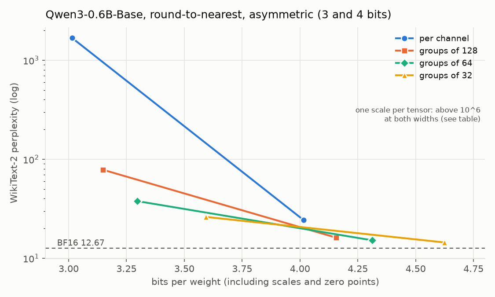
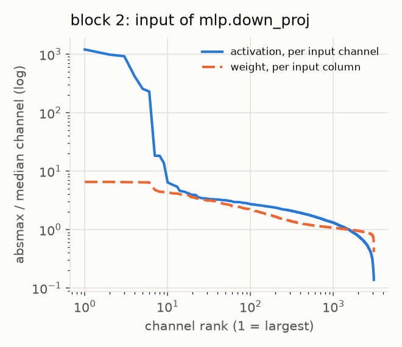

# Quantized Inference Lab

Post-training quantization of LLMs, written from scratch and measured end to end. The work
covers:

* quantizing real models (Qwen3) with round-to-nearest, GPTQ, AWQ and SmoothQuant, plus FP8,
  NF4 and KV-cache quantization;
* checking each method against llm-compressor;
* running 4-bit weights through a hand-written Triton kernel;
* exporting checkpoints that vLLM serves;
* measuring perplexity, accuracy, memory and speed at every step.

Every number in this README is generated by `scripts/gen_readme.py` from a CSV in
`results/`. Each CSV has a `.meta.json` next to it that records the GPU, driver, package
versions, git revision and load average of the run. CI fails if the README and the results
files disagree.

## Status

| Milestone | What | State |
|---|---|---|
| M0 | Integer formats, real 4-bit packing, honest byte accounting, tests, CI | done |
| M1 | Perplexity evaluation on a real model; RTN baselines; activation outliers; block offload | done |
| M2 | GPTQ, AWQ, SmoothQuant, FP8 / NF4, KV-cache quantization, checked against llm-compressor | done on the box; cross-check running |
| M3 | Triton W4A16 kernel vs cuBLAS, vLLM Marlin and bitsandbytes | done on the box |
| M4 | Export to GPTQ / AWQ checkpoints; vLLM perplexity parity and serving benchmarks | done on the box |
| M5 | The same pipeline on Qwen3-8B on an H200 | submitted |

Development runs on a laptop RTX 3050 Ti (4 GB, Ampere) with Qwen3-0.6B and, through block
offload, Qwen3-1.7B and 4B. The final runs (M5) repeat the same scripts on datacenter GPUs,
in the same software environment.

## Formats and how size is counted

`qlab/formats.py` implements integer weight quantization for `[out, in]` matrices:

* **Granularity:** one scale per tensor, per output channel, or per group of `G` consecutive
  input columns in each row.
* **Symmetric:** the zero point is fixed at `2^(b-1)` and `scale = absmax / (2^(b-1) - 1)`.
* **Asymmetric:** `[min(w,0), max(w,0)]` maps onto all `2^b` codes with an integer zero
  point.
* **Also:** NF4 (the QLoRA codebook) and FP8 E4M3.

Every value in range round-trips with error at most `scale / 2`; this is tested for 2 to 8
bits at every granularity.

Size counts everything stored. Codes are packed densely, scales are FP16, and asymmetric
zero points are packed at `b` bits. Bits per weight is therefore `b + (16 + b·asym) / G`: for
example 4.125 for symmetric 4-bit with groups of 128, and 4.156 for asymmetric.
`qlab/packing.py` packs two 4-bit codes per byte. It also implements the GPTQ `int32`
`qweight` / `qzeros` layout that vLLM loads.

### Synthetic warm-up

`python -m qlab simulate` quantizes two 1024 × 4096 matrices:

* a standard Gaussian;
* the same Gaussian with 1% of its input columns scaled by 20×, mimicking the outlier
  channels of real LLM weights.

On the Gaussian, the error follows the uniform-noise model `scale² / 12` (a unit test checks
this). With outliers present, one scale per tensor or per row loses most of its precision to
the few large columns. Small groups confine the damage to the groups that contain an outlier.

<!-- qlab:begin m0_simulate -->
| Format | Bits/weight | MSE (Gaussian) | SQNR dB | MSE (outliers) | SQNR dB |
|---|---|---|---|---|---|
| fp32 | 32.000 | 0.00e+00 | ∞ | 0.00e+00 | ∞ |
| int8 tensor asym | 8.000 | 1.26e-04 | 39.0 | 3.41e-02 | 21.7 |
| int8 channel asym | 8.006 | 6.78e-05 | 41.7 | 9.99e-03 | 27.0 |
| int8 g128 asym | 8.188 | 3.50e-05 | 44.6 | 8.51e-04 | 37.7 |
| int4 tensor asym | 4.000 | 3.63e-02 | 14.4 | 1.09e+00 | 6.6 |
| int4 channel asym | 4.005 | 1.96e-02 | 17.1 | 9.95e-01 | 7.0 |
| int4 g128 asym | 4.156 | 1.01e-02 | 19.9 | 2.01e-01 | 14.0 |
| int3 tensor asym | 3.000 | 1.67e-01 | 7.8 | 1.44e+00 | 5.4 |
| int3 channel asym | 3.005 | 9.00e-02 | 10.5 | 1.12e+00 | 6.5 |
| int3 g128 asym | 3.148 | 4.65e-02 | 13.3 | 4.64e-01 | 10.3 |

<sub>Source: `results/box/m0_simulate.csv` · CPU · torch 2.14.0 · git d5c42f8 · 2026-11-20</sub>
<!-- qlab:end m0_simulate -->

## M1: round-to-nearest on a real model

**Model and evaluation.** Qwen3-0.6B-Base in BF16. Perplexity follows the GPTQ paper's
protocol:

* WikiText-2 test: 2048-token windows over the joined test split;
* C4 validation: the first 256 windows of the first 1100 documents.

Embeddings and `lm_head` stay 16-bit, as in every 4-bit checkpoint format. Each cell below is
WikiText-2 / C4 perplexity for round-to-nearest (RTN) weights:

<!-- qlab:begin m1_rtn -->
| Scales | int8 sym | int8 asym | int4 sym | int4 asym | int3 sym | int3 asym |
|---|---|---|---|---|---|---|
| per tensor | 13.20 / 20.78 | 13.12 / 20.68 | 1.3e+08 / 1.2e+08 | 8.6e+06 / 4.6e+06 | 4.3e+05 / 4.6e+05 | 8.6e+07 / 1.0e+08 |
| per channel | 12.72 / 19.97 | 12.71 / 19.96 | 30.48 / 45.33 | 24.30 / 36.95 | 2.0e+05 / 1.5e+05 | 1.7e+03 / 2.0e+03 |
| groups of 128 | 12.70 / 19.95 | 12.70 / 19.93 | 18.55 / 28.85 | 16.16 / 25.11 | 548.05 / 758.87 | 78.31 / 117.55 |
| groups of 64 | 12.70 / 19.94 | 12.69 / 19.93 | 16.58 / 25.62 | 15.18 / 23.62 | 156.52 / 252.68 | 37.78 / 59.14 |
| groups of 32 | 12.69 / 19.93 | 12.68 / 19.92 | 15.33 / 24.12 | 14.44 / 22.50 | 62.41 / 93.29 | 26.15 / 40.02 |

BF16 baseline: 12.67 / 19.89. Each cell is WikiText-2 / C4 perplexity.

<sub>Source: `results/box/m1_rtn.csv` · NVIDIA GeForce RTX 3050 Ti Laptop GPU · torch 2.14.0 · git dff0328 · 2026-11-21</sub>
<!-- qlab:end m1_rtn -->



* **8 bits** costs almost nothing at any granularity finer than one scale per tensor.
* **At 4 and 3 bits, one scale per tensor collapses the model.** A few large weights set the
  scale, and everything else rounds to a handful of levels.
* **Finer 4-bit scales recover most of the loss,** for a fraction of a bit per weight
  each. Asymmetric beats symmetric at every 4-bit granularity.
* **RTN is not usable at 3 bits** even with small groups; that is the gap GPTQ and AWQ
  target in M2.

### Why: activation outliers

A forward hook records the largest absolute value of every input channel of every linear
over 32 calibration windows. It compares that with the largest weight in the same input
column.

<!-- qlab:begin m1_outliers -->
| Linear input | Activation max/median (median over blocks) | worst block | Weight max/median (median over blocks) | worst block |
|---|---|---|---|---|
| q/k/v input (after input RMSNorm) | 12× | 37× | 2× | 4× |
| o_proj input (attention output) | 4× | 16× | 3× | 6× |
| gate/up input (after post-attention RMSNorm) | 10× | 58× | 3× | 8× |
| down_proj input (SwiGLU output) | 8× | 1207× | 5× | 8× |

<sub>Source: `results/box/m1_outliers_summary.csv` · NVIDIA GeForce RTX 3050 Ti Laptop GPU · torch 2.14.0 · git cd0c92e · 2026-11-21</sub>
<!-- qlab:end m1_outliers -->



In block 2, a handful of the channels entering `down_proj` are two to three orders of
magnitude above the median channel; the weights never get beyond a few times their median.
One INT8 scale per sequence has to cover those few channels, so every other channel is left
with a handful of levels. Per-token scales only partly avoid this, which is why the
calibrated methods in M2 exist. The effect on W8A8:

<!-- qlab:begin m1_w8a8 -->
| Weights | Activations | WikiText-2 | C4 |
|---|---|---|---|
| 16-bit | 16-bit | 12.67 | 19.89 |
| int8 channel sym | int8 per-tensor | 21.49 | 32.97 |
| int8 channel sym | int8 per-token | 13.01 | 20.40 |
| 16-bit | int8 per-tensor | 21.26 | 32.77 |
| 16-bit | int8 per-token | 12.99 | 20.35 |
| int8 channel sym | 16-bit | 12.72 | 19.97 |

<sub>Source: `results/box/m1_rtn.csv` · NVIDIA GeForce RTX 3050 Ti Laptop GPU · torch 2.14.0 · git dff0328 · 2026-11-21</sub>
<!-- qlab:end m1_w8a8 -->

### Block offload

`qlab/sequential.py` runs the decoder one block at a time, keeping the hidden states between
blocks in CPU memory. GPTQ and AWQ need exactly this to calibrate each block on the outputs
of the blocks before it, and it is also what lets models larger than the 4 GB card run.
Tests check it against the plain forward pass. Here it runs Qwen3-1.7B, whose BF16 weights
alone take 3.4 GB:

<!-- qlab:begin m1_offload -->
| Model | Weights | Bits/weight | Model MB | WikiText-2 | Eval s |
|---|---|---|---|---|---|
| Qwen3-1.7B-Base | 16-bit | 16.00 | 3282 | 9.40 | 140.9 |
| Qwen3-1.7B-Base | int4 g128 asym | 4.16 | 1292 | 11.53 | 131.1 |
| Qwen3-1.7B-Base | int4 channel asym | 4.01 | 1267 | 16.86 | 130.5 |

<sub>Source: `results/box/m1_offload.csv` · NVIDIA GeForce RTX 3050 Ti Laptop GPU · torch 2.14.0 · git dff0328 · 2026-11-21</sub>
<!-- qlab:end m1_offload -->

## M2: calibrated methods

All methods are implemented in `qlab/` from the papers. Calibration uses 128 windows from C4
train: 2048 tokens each for GPTQ, 512 for AWQ and SmoothQuant.

* **GPTQ** (`qlab/gptq.py`): layer-wise Hessian `2XXᵀ` with 1% dampening; Cholesky of
  `H⁻¹`; lazy batch updates in blocks of 128.
  - Group-wise scales are taken from the error-updated weights.
  - Optional act-order.
  - "True sequential": `o_proj` is calibrated on the outputs of the quantized q/k/v.
* **AWQ** (`qlab/awq.py`):
  - Per-channel scales `mean|x|^α`, with a 20-point grid search on each group's output
    error.
  - The scales are folded into the preceding RMSNorm or linear.
  - Then a clipping search on `||Wx − Q(W)x||`.
* **SmoothQuant** (`qlab/smoothquant.py`): `s = max|X|^α / max|W|^(1−α)`, folded into the
  norms. Then INT8 per-channel weights and INT8 per-token activations.
* **KV cache** (`qlab/kvquant.py`): keys and values are fake-quantized inside attention,
  after RoPE. Two layouts:
  - per (token, head);
  - KIVI-style: keys per channel over groups of 128 tokens, values per token.

What the table shows:

* **4 bits, groups of 128:** both calibrated methods recover a large share of RTN's
  perplexity increase. AWQ is ahead of GPTQ on this model.
* **3 bits:** calibration decides whether the model works at all. RTN is unusable, and GPTQ
  and AWQ bring it back into a usable range.
* **Coarse scales:** with one scale per output channel, GPTQ's error compensation matters
  most, but groups still help more.
* **Small effects:** act-order and AWQ's clipping search barely move the numbers here.
  Symmetric weights cost some perplexity; GPTQ-Marlin requires them.
* **NF4 (data-free, groups of 64)** lands close to calibrated INT4 for a little more storage.
  FP8 is nearly lossless even with one scale per tensor, because its exponent covers the
  range.
* **Model size:** the 151k-token embedding (16-bit, tied with `lm_head`) dominates it at
  4 bits, so the saving is far below 4×. On larger models it shrinks toward the linears'
  ratio.

<!-- qlab:begin m2_methods -->
| Method | Weights | Bits/weight | Model MB | WikiText-2 | C4 | Quantize s |
|---|---|---|---|---|---|---|
| BF16 | 16-bit | 16.00 | 1137 | 12.67 | 19.89 | 0.0 |
| RTN | fp8 channel | 8.01 | 718 | 12.76 | 20.02 | 0.3 |
| RTN | fp8 tensor | 8.00 | 717 | 12.75 | 20.02 | 0.3 |
| RTN | int4 channel asym | 4.02 | 508 | 24.30 | 36.95 | 0.4 |
| GPTQ | int4 channel asym | 4.02 | 508 | 17.44 | 26.86 | 332.8 |
| RTN | int4 g128 asym | 4.16 | 515 | 16.16 | 25.11 | 0.8 |
| GPTQ | int4 g128 asym | 4.16 | 515 | 14.78 | 23.04 | 416.7 |
| GPTQ (act-order) | int4 g128 asym | 4.16 | 515 | 14.88 | 23.27 | 333.9 |
| AWQ | int4 g128 asym | 4.16 | 515 | 14.24 | 22.14 | 271.2 |
| AWQ (no clip search) | int4 g128 asym | 4.16 | 515 | 14.25 | 22.14 | 259.9 |
| AWQ (saved for export) | int4 g128 asym | 4.16 | 515 | 14.24 | 22.14 | 263.8 |
| GPTQ (saved for export) | int4 g128 sym | 4.12 | 513 | 15.73 | 24.22 | 341.5 |
| RTN | nf4 g64 | 4.25 | 520 | 14.80 | 23.30 | 0.4 |
| RTN | int3 g128 asym | 3.15 | 462 | 78.31 | 117.55 | 0.4 |
| GPTQ | int3 g128 asym | 3.15 | 462 | 26.52 | 40.27 | 341.4 |
| AWQ | int3 g128 asym | 3.15 | 462 | 23.13 | 33.87 | 266.1 |

<sub>Source: `results/box/m2_methods.csv` · NVIDIA GeForce RTX 3050 Ti Laptop GPU · torch 2.14.0 · git 5179acf · 2026-11-21</sub>
<!-- qlab:end m2_methods -->

### W8A8

SmoothQuant moves most of the per-token W8A8 loss into the weights, where 8 bits absorbs
it. It also helps a lot with one activation scale per sequence, but cannot close that gap:
the largest outliers (M1) are in the input of `down_proj`, which has no preceding norm to
fold the scale into for free.

<!-- qlab:begin m2_w8a8 -->
| Method | Weights | Activations | WikiText-2 | C4 |
|---|---|---|---|---|
| RTN | int8 channel sym | int8 per-token | 13.01 | 20.40 |
| RTN | int8 channel sym | int8 per-tensor | 21.49 | 32.97 |
| SmoothQuant (α=0.5) | int8 channel sym | int8 per-token | 12.88 | 20.22 |
| SmoothQuant (α=0.75) | int8 channel sym | int8 per-token | 12.86 | 20.15 |
| SmoothQuant (α=0.5) | int8 channel sym | int8 per-tensor | 17.50 | 26.85 |
| SmoothQuant (α=0.75) | int8 channel sym | int8 per-tensor | 17.52 | 26.80 |

<sub>Source: `results/box/m2_methods.csv` · NVIDIA GeForce RTX 3050 Ti Laptop GPU · torch 2.14.0 · git 5179acf · 2026-11-21</sub>
<!-- qlab:end m2_w8a8 -->

### KV cache

**INT8 per token** costs almost nothing.

**INT4 per token collapses the model.** Keys have a few outlier channels, and with one scale
per token those channels set every token's scale.

**The KIVI layout fixes it.** Keys get one scale per channel over groups of 128 tokens and
values one per token, which brings INT4 back to near the 16-bit baseline at a quarter of the
memory. At 2 bits even KIVI degrades.

<!-- qlab:begin m2_kv -->
| Weights | KV cache | KV bytes/token | KV at 32k tokens | WikiText-2 | C4 |
|---|---|---|---|---|---|
| 16-bit | 16-bit | 114,688 | 3,584 MB | 12.67 | 19.89 |
| 16-bit | int8 token | 59,136 | 1,848 MB | 12.77 | 20.05 |
| 16-bit | int4 token | 30,464 | 952 MB | 3.5e+03 | 4.0e+03 |
| 16-bit | int4 kivi | 30,464 | 952 MB | 12.93 | 20.28 |
| 16-bit | int2 kivi | 16,128 | 504 MB | 46.32 | 70.87 |
| GPTQ int4 g128 asym | int8 token | 59,136 | 1,848 MB | 14.96 | 23.29 |

<sub>Source: `results/box/m2_methods.csv` · NVIDIA GeForce RTX 3050 Ti Laptop GPU · torch 2.14.0 · git 5179acf · 2026-11-21</sub>
<!-- qlab:end m2_kv -->

### Cross-check against llm-compressor

<!-- qlab:begin m2_reference -->
_Not run yet._
<!-- qlab:end m2_reference -->

Zero-shot accuracy (lm-eval) is measured on Qwen3-8B in M5 rather than on the 0.6B
development model.

## M3: a Triton W4A16 kernel

`qlab/kernels/w4a16.py` computes `y = x · dequant(W)ᵀ` straight from the GPTQ checkpoint
layout: 4-bit codes eight per `int32` along K, with group-wise scales and zero points.

* **M = 1 (decode): a GEMV without tensor cores.**
  - Each packed word is loaded once and unpacked to all eight rows by a broadcast shift.
  - Dequantization is one FMA per weight.
  - Accumulation is element-wise in FP32, reduced once at the end; split-K combines with
    atomics.
* **M > 1 (batched decode, prefill): tensor cores.** The same packed load and unpack feeds
  `tl.dot`.
* Both kernels are autotuned per shape.

The first version loaded each packed word once per row it held and used `tl.dot` for every
M. On this card it reached about a third of copy bandwidth at decode and half of cuBLAS
speed at prefill; the two changes above fixed most of both. Timings replay each call in a
CUDA graph, as decoding does.

It is checked against dequantize-then-matmul on every linear shape of Qwen3-0.6B, 1.7B and
8B, at batch sizes 1–16 and prefill sizes. The same packed tensors also run through vLLM's
Marlin kernel, which matches the same reference. That is how the checkpoint layout is known
to be the one vLLM expects.

<!-- qlab:begin m3_kernels -->
| Model | M (tokens) | bf16 cuBLAS µs | qlab triton µs | qlab triton sym µs | vLLM marlin µs | bnb nf4 µs | triton vs bf16 | triton sym vs marlin |
|---|---|---|---|---|---|---|---|---|
| qwen3-0.6b | 1 | 208 | 78 | 78 | 60 | 109 | 2.67× | 0.77× |
| qwen3-0.6b | 2 | 211 | 117 | 117 | 59 | 151 | 1.80× | 0.50× |
| qwen3-0.6b | 4 | 213 | 118 | 118 | 59 | 266 | 1.80× | 0.50× |
| qwen3-0.6b | 8 | 216 | 121 | 121 | 61 | 433 | 1.78× | 0.51× |
| qwen3-0.6b | 16 | 221 | 127 | 128 | 81 | 438 | 1.74× | 0.63× |
| qwen3-0.6b | 64 | 284 | 297 | 297 | 237 | 472 | 0.96× | 0.80× |
| qwen3-0.6b | 256 | 820 | 952 | 950 | 733 | 1088 | 0.86× | 0.77× |
| qwen3-0.6b | 1024 | 2785 | 3070 | 3057 | 2624 | 3098 | 0.91× | 0.86× |
| qwen3-1.7b | 1 | 623 | 236 | 236 | 189 | 299 | 2.64× | 0.80× |
| qwen3-1.7b | 2 | 696 | 362 | 361 | 188 | 412 | 1.92× | 0.52× |
| qwen3-1.7b | 4 | 699 | 369 | 365 | 190 | 705 | 1.89× | 0.52× |
| qwen3-1.7b | 8 | 704 | 380 | 377 | 195 | 787 | 1.85× | 0.52× |
| qwen3-1.7b | 16 | 716 | 396 | 393 | 228 | 797 | 1.81× | 0.58× |
| qwen3-1.7b | 64 | 943 | 800 | 802 | 598 | 1151 | 1.18× | 0.75× |
| qwen3-1.7b | 256 | 2352 | 2416 | 2411 | 2094 | 3267 | 0.97× | 0.87× |
| qwen3-1.7b | 1024 | 8435 | 9440 | 9401 | 8024 | 9354 | 0.89× | 0.85× |
| qwen3-8b | 1 | 2284 | 835 | 835 | 643 | 1111 | 2.73× | 0.77× |
| qwen3-8b | 2 | 2620 | 1240 | 1233 | 644 | 1534 | 2.11× | 0.52× |
| qwen3-8b | 4 | 2555 | 1256 | 1251 | 649 | 2330 | 2.03× | 0.52× |
| qwen3-8b | 8 | 2563 | 1295 | 1289 | 658 | 2367 | 1.98× | 0.51× |
| qwen3-8b | 16 | 2622 | 1347 | 1341 | 788 | 2406 | 1.95× | 0.59× |
| qwen3-8b | 64 | 3113 | 2836 | 2835 | 2034 | 3973 | 1.10× | 0.72× |
| qwen3-8b | 256 | 8673 | 8918 | 8902 | 7916 | 12214 | 0.97× | 0.89× |
| qwen3-8b | 1024 | 30816 | 35268 | 35117 | 30730 | 34474 | 0.87× | 0.88× |

Time for all linear layers of one decoder block (q, k, v, o, gate, up, down), summed from per-shape medians. "triton sym vs marlin" above 1× means qlab's kernel is faster than Marlin on the same symmetric weights.

<sub>Source: `results/box/m3_kernels.csv` · NVIDIA GeForce RTX 3050 Ti Laptop GPU · torch 2.14.0 · git 5179acf · 2026-11-21</sub>
<!-- qlab:end m3_kernels -->

Where it stands against the alternatives on the same card:

* **Batch-1 decode:** the GEMV is well ahead of 16-bit cuBLAS on every model size, and within
  reach of vLLM's Marlin, a hand-written CUDA kernel, without matching it.
* **M = 2 to 16:** the tensor-core path still beats 16-bit, but Marlin is about twice as fast.
  This is the main gap left. Marlin keeps the dequantized tile in the tensor-core operand
  layout; the Triton kernel converts it through shared memory every step.
* **Prefill:** both 4-bit kernels run close to 16-bit cuBLAS, as expected once the matmul is
  compute-bound.

Decode (M = 1) is limited by memory bandwidth. Effective bandwidth counts the bytes each
kernel must read and write, as a share of this GPU's measured device-to-device copy
bandwidth. A copy both reads and writes, so a kernel that mostly reads, like 16-bit GEMV,
can slightly exceed 100%.

<!-- qlab:begin m3_bandwidth -->
| Model | K × N | bf16 cuBLAS % of copy BW | qlab triton % of copy BW | qlab triton sym % of copy BW | vLLM marlin % of copy BW | bnb nf4 % of copy BW |
|---|---|---|---|---|---|---|
| qwen3-0.6b | 1024 × 2048 | 92.8 | 62.0 | 61.9 | 80.2 | 49.6 |
| qwen3-0.6b | 1024 × 1024 | 97.1 | 54.1 | 53.8 | 59.2 | 41.9 |
| qwen3-0.6b | 2048 × 1024 | 83.9 | 58.9 | 58.9 | 77.8 | 49.0 |
| qwen3-0.6b | 1024 × 3072 | 94.4 | 69.0 | 69.4 | 93.4 | 50.8 |
| qwen3-0.6b | 3072 × 1024 | 88.1 | 67.5 | 68.0 | 93.7 | 53.4 |
| qwen3-1.7b | 2048 × 2048 | 96.0 | 62.0 | 61.5 | 82.4 | 56.0 |
| qwen3-1.7b | 2048 × 1024 | 84.9 | 60.4 | 60.5 | 79.4 | 50.3 |
| qwen3-1.7b | 2048 × 6144 | 101.2 | 70.3 | 70.1 | 82.0 | 58.5 |
| qwen3-1.7b | 6144 × 2048 | 98.0 | 68.6 | 68.5 | 88.9 | 59.6 |
| qwen3-8b | 4096 × 4096 | 101.8 | 69.7 | 69.9 | 88.1 | 60.3 |
| qwen3-8b | 4096 × 1024 | 91.0 | 60.3 | 60.3 | 88.5 | 55.9 |
| qwen3-8b | 4096 × 12288 | 103.4 | 76.7 | 76.6 | 95.1 | 59.0 |
| qwen3-8b | 12288 × 4096 | 103.0 | 70.3 | 70.4 | 96.8 | 59.8 |

<sub>Source: `results/box/m3_kernels.csv` · NVIDIA GeForce RTX 3050 Ti Laptop GPU · torch 2.14.0 · git 5179acf · 2026-11-21</sub>
<!-- qlab:end m3_bandwidth -->

End to end, every decoder linear of Qwen3-0.6B is replaced by `QuantLinear`. A test checks
that the swapped model computes the same function as the fake-quantized one. The result is
timed in greedy batch-1 decoding with a static cache (compiled with CUDA graphs).

On this model the 16-bit embedding and `lm_head` (311 MB, read every token) stay as they
are, which caps the possible speedup well below the linears' 4×. Qwen3-8B on Explorer (M5)
is the test for a larger share of quantized weights.

<!-- qlab:begin m3_e2e -->
| Model | Linear weights | Weights MB | Decode tokens/s | ms/token | Prefill ms | Peak MB | Speedup |
|---|---|---|---|---|---|---|---|
| Qwen3-0.6B-Base | 16-bit | 1137 | 88.1 | 11.351 | 24.68 | 1233 | 1.00× |
| Qwen3-0.6B-Base | int4 g128 asym (qlab triton) | 515 | 126.7 | 7.896 | 36.46 | 616 | 1.44× |

<sub>Source: `results/box/m3_e2e.csv` · NVIDIA GeForce RTX 3050 Ti Laptop GPU · torch 2.14.0 · git 5179acf · 2026-11-21</sub>
<!-- qlab:end m3_e2e -->

## M4: vLLM checkpoints and serving

`qlab export` writes quantized runs as checkpoints vLLM loads natively:

* GPTQ format for symmetric weights (served by GPTQ-Marlin);
* AWQ format for asymmetric weights (AWQ-Marlin).

The check that the export is right: vLLM's own perplexity on the same WikiText-2 windows,
from prompt log-probabilities, must match qlab's evaluation of the same run.

<!-- qlab:begin m4_parity -->
_Not run yet._
<!-- qlab:end m4_parity -->

The exports load through vLLM's own loader and kernels (GPTQ-Marlin, AWQ-Marlin), and
their perplexity matches qlab's evaluation of the same runs.

Serving uses `vllm serve` with a fixed prompt, 128 generated tokens per request and streamed
responses, 60 s per concurrency level. The load generator is the one from the
inference-control-plane project. On a 4 GB card, memory not spent on weights goes to the KV
cache. The 4-bit checkpoints therefore hold far more tokens of context in flight than BF16,
which shows at high concurrency.

<!-- qlab:begin m4_serve -->
_Not run yet._
<!-- qlab:end m4_serve -->

### A 4B model on a 4 GB laptop GPU

Qwen3-4B-Base needs about 8 GB in BF16, twice this card's memory. GPTQ through block offload
quantizes it on the same card, one decoder block at a time. The symmetric 4-bit export then
serves with vLLM's GPTQ-Marlin kernel, where the BF16 model cannot load.

<!-- qlab:begin m4_qwen3_4b -->
_Not run yet._
<!-- qlab:end m4_qwen3_4b -->

<!-- qlab:begin m4_serve_4b -->
_Not run yet._
<!-- qlab:end m4_serve_4b -->

## Running it

On the development box, everything runs in one container built from
`vllm/vllm-openai:v0.34.0` plus the pinned extras in `docker/requirements.lock`.
llm-compressor, used only for the cross-check, has its own image (`docker/Dockerfile.ref`)
because it pins a different transformers.

```bash
scripts/build_image.sh
```

```bash
scripts/dev.sh 'pytest -q'
```

```bash
scripts/dev.sh 'python3 -m qlab run configs/m2_methods_qwen3-0.6b.yaml --out results/box/m2_methods.csv'
```

```bash
scripts/queue_box.sh m2 m3 m4ref m4 m2extra m2ref
```

```bash
python3 scripts/gen_readme.py
```

Without Docker, the CPU parts need only PyTorch (plus transformers for the model tests):

```bash
pip install -e ".[dev,model]" && pytest -q
```

## Layout

```
qlab/formats.py       integer / NF4 / FP8 formats, scale and zero computation, size accounting
qlab/packing.py       int4 byte packing and the GPTQ int32 layout
qlab/sequential.py    block-by-block execution (calibration and offload)
qlab/eval/ppl.py      perplexity (GPTQ protocol), chunked lm_head
qlab/rtn.py gptq.py awq.py smoothquant.py actquant.py kvquant.py
qlab/experiments.py   YAML experiment runner (sweeps, resumable CSVs)
qlab/kernels/w4a16.py Triton W4A16 kernel; qlab/qlinear.py drop-in QuantLinear
qlab/export.py        GPTQ / AWQ checkpoint writer for vLLM
bench/                kernel microbenchmarks, end-to-end decode, vLLM perplexity and serving
configs/              experiment configs (box: Qwen3-0.6B / 1.7B / 4B; m5/: Qwen3-8B)
scripts/              dev container, run scripts, README generator, plots
slurm/                Explorer (Slurm + Apptainer) job scripts
results/box/          measured on the development box
results/explorer/     measured on datacenter GPUs
tests/                unit tests (GPU and model tests are marked and skipped when unavailable)
```
